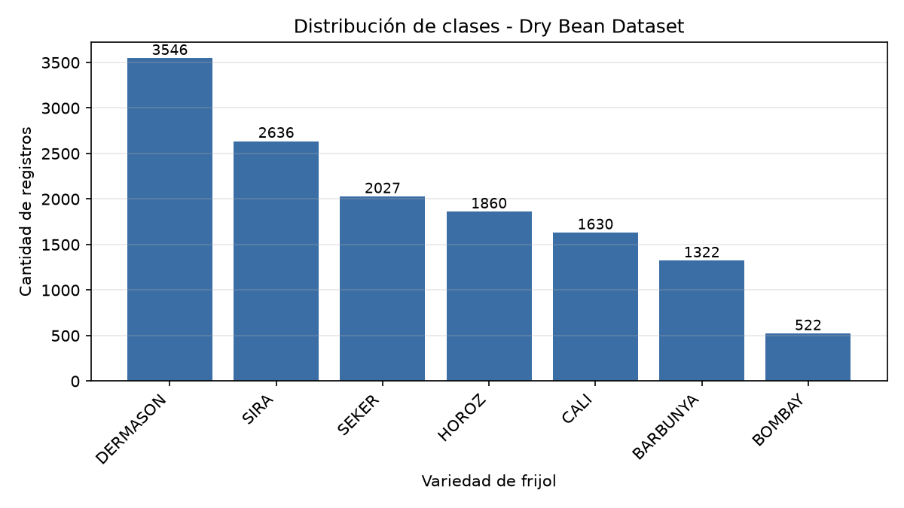
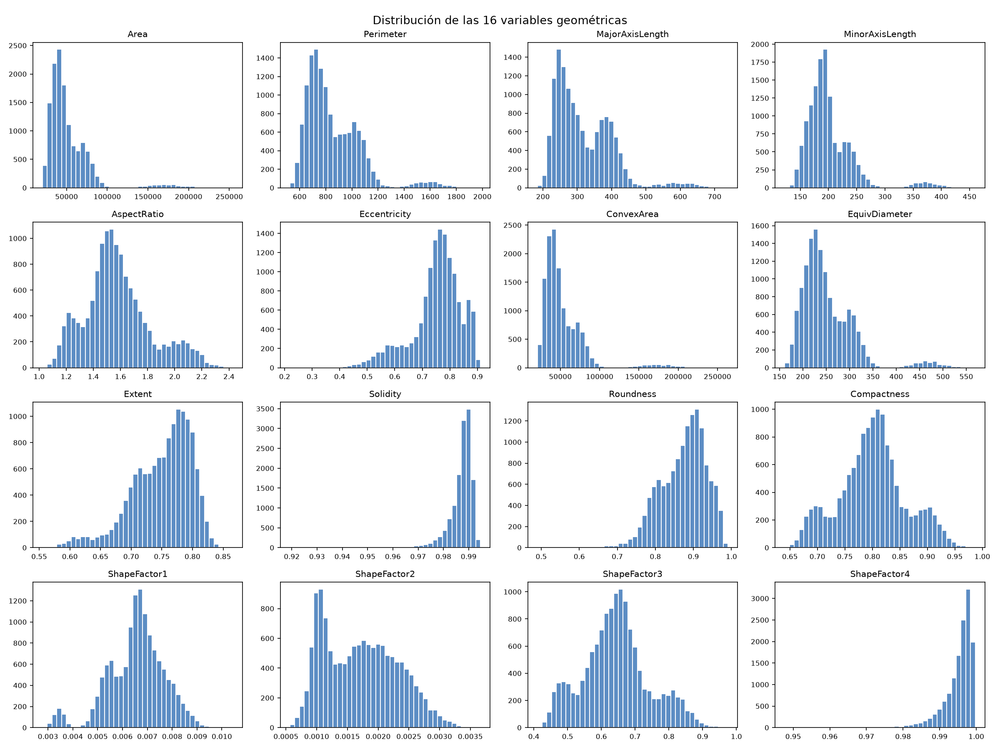
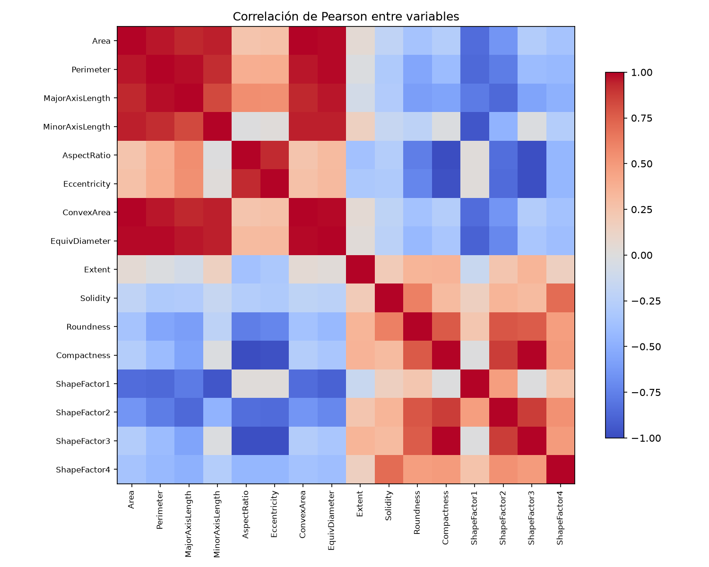
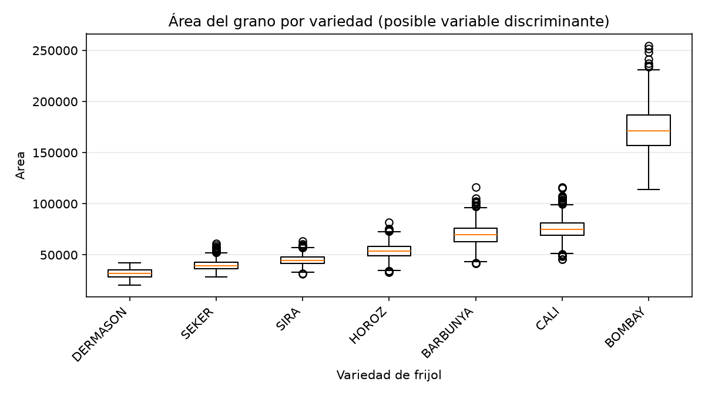

# Reporte Sprint 1 - Comprensión y preparación de datos

**Proyecto:** Clasificación de variedades de frijol seco (Dry Bean Dataset)
**Metodologías:** CRISP-DM · TDSP · Scrum ML
**Fuente:** https://archive.ics.uci.edu/dataset/602/dry+bean+dataset
**Semilla:** `random_state=42` · **Test:** 20% estratificado

## 1. Comprensión del negocio

Una empresa agrícola quiere automatizar el control de calidad de granos de
frijol. El objetivo es predecir la variedad (`Class`) a partir de 16 medidas
geométricas obtenidas por visión por computador, reduciendo la clasificación
manual. Es un problema de **clasificación multiclase supervisada**.

## 2. Comprensión de los datos

- Registros originales: **13611**
- Columnas: **17** (16 variables + `Class`)
- Variables numéricas: **16** · columnas no numéricas distintas del objetivo: ninguna
- Clases: **7** · relación entre la clase mayor y la menor: **6.79:1**

### Distribución de clases

| Clase | registros | % del total |
|---|---|---|
| DERMASON | 3546 | 26.050 |
| SIRA | 2636 | 19.370 |
| SEKER | 2027 | 14.890 |
| HOROZ | 1928 | 14.170 |
| CALI | 1630 | 11.980 |
| BARBUNYA | 1322 | 9.710 |
| BOMBAY | 522 | 3.840 |

Las clases **no están balanceadas**: `DERMASON` concentra la mayor cantidad de
registros y `BOMBAY` la menor. Esto justifica reportar **F1 macro** además de
accuracy y usar `class_weight="balanced"` en el modelo alternativo.

### Estadísticas descriptivas

| Variable | mean | std | min | 50% | max |
|---|---|---|---|---|---|
| Area | 53048.460 | 29392.438 | 20420.000 | 44580.000 | 254616.000 |
| Perimeter | 854.993 | 214.723 | 524.736 | 793.896 | 1985.370 |
| MajorAxisLength | 319.896 | 85.809 | 183.601 | 296.405 | 738.860 |
| MinorAxisLength | 202.365 | 45.052 | 122.513 | 192.491 | 460.198 |
| AspectRatio | 1.581 | 0.245 | 1.025 | 1.550 | 2.430 |
| Eccentricity | 0.750 | 0.092 | 0.219 | 0.764 | 0.911 |
| ConvexArea | 53767.987 | 29844.249 | 20684.000 | 45122.000 | 263261.000 |
| EquivDiameter | 253.034 | 59.308 | 161.244 | 238.246 | 569.374 |
| Extent | 0.750 | 0.049 | 0.555 | 0.760 | 0.866 |
| Solidity | 0.987 | 0.004650 | 0.919 | 0.988 | 0.995 |
| Roundness | 0.874 | 0.059 | 0.490 | 0.883 | 0.991 |
| Compactness | 0.800 | 0.061 | 0.641 | 0.802 | 0.987 |
| ShapeFactor1 | 0.006561 | 0.001130 | 0.002778 | 0.006643 | 0.010 |
| ShapeFactor2 | 0.001719 | 0.000595 | 0.000564 | 0.001700 | 0.003665 |
| ShapeFactor3 | 0.644 | 0.099 | 0.410 | 0.642 | 0.975 |
| ShapeFactor4 | 0.995 | 0.004347 | 0.948 | 0.996 | 1.000 |

### Correlaciones más fuertes

- `Area` y `ConvexArea`: r = 1.000
- `Compactness` y `ShapeFactor3`: r = 0.999
- `Perimeter` y `EquivDiameter`: r = 0.991
- `AspectRatio` y `Compactness`: r = -0.988
- `ConvexArea` y `EquivDiameter`: r = 0.985

Se observan correlaciones muy altas entre variables de tamaño (`Area`,
`Perimeter`, `ConvexArea`, `EquivDiameter`). Para modelos lineales conviene el
escalamiento; para modelos de árboles no es obligatorio.

## 3. Calidad de datos

| Chequeo | Resultado |
|---|---|
| Valores nulos totales | 0 |
| Columnas con nulos | 0 |
| Filas duplicadas | 68 |
| Filas eliminadas en limpieza | 68 |
| Registros finales | 13543 |

Acciones aplicadas:

- drop_duplicates(): se eliminan filas idénticas completas.
- index reindexado con reset_index(drop=True).

## 4. Preparación

- **X:** 16 variables numéricas · **y:** `Class`
- **Train:** 10834 registros (80.0%)
- **Test:** 2709 registros (20.0%)
- **Estratificación:** proporciones de clase equivalentes en train y test (ver JSON de resumen).
- **Pipeline:** `Pipeline(steps=[('scaler', StandardScaler())])` — se ajusta solo con train
  para evitar fuga de información.

## 5. Figuras generadas

### Distribución de clases

### Histogramas de las variables

### Matriz de correlación

### Área por variedad

## 6. Conclusiones del Sprint 1

1. El dataset se carga de forma reproducible desde UCI y queda versionado en `data/raw/`.
2. No hay valores nulos y los duplicados se eliminaron de forma documentada.
3. El desbalance de clases obliga a mirar F1 macro y no solo accuracy.
4. Las variables de tamaño dominan la estructura de correlación, lo que anticipa
   un buen desempeño en clasificación.
5. El split estratificado y el pipeline dejan el terreno listo para el Sprint 2.
