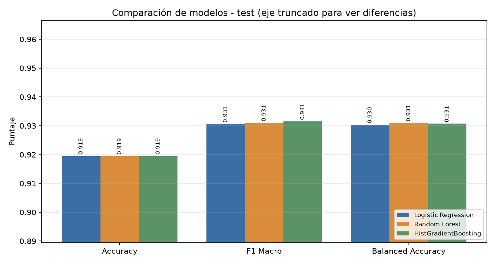
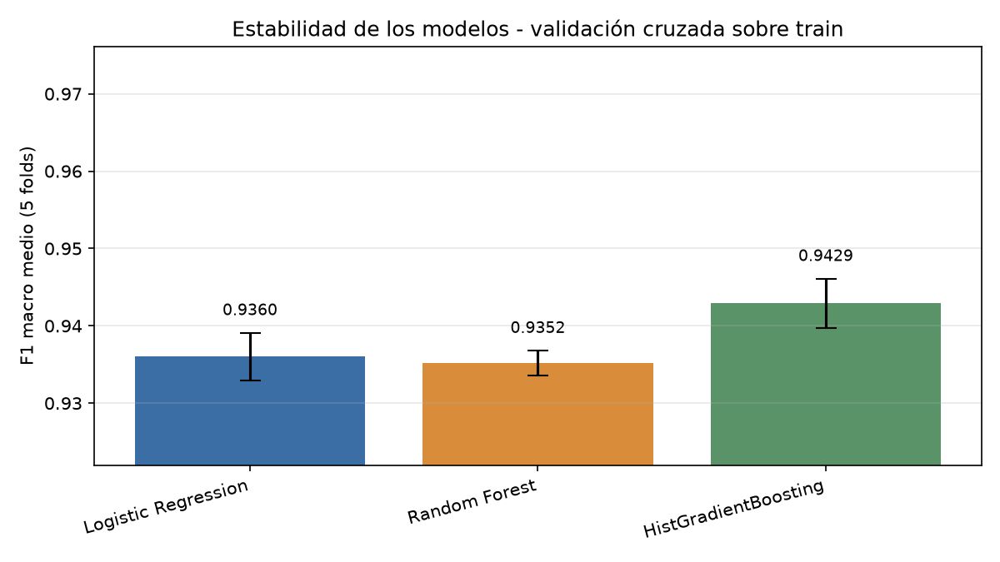
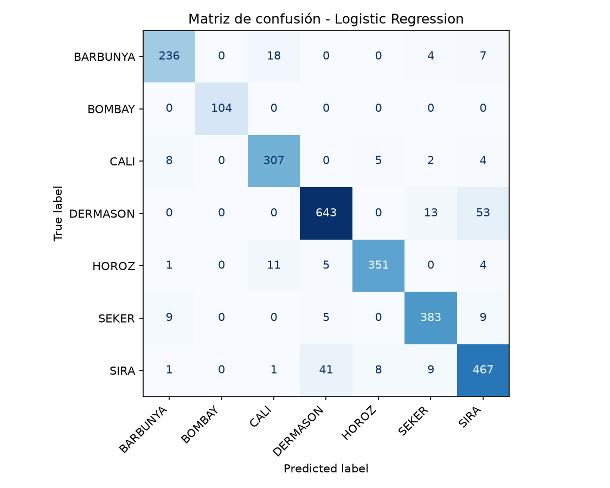
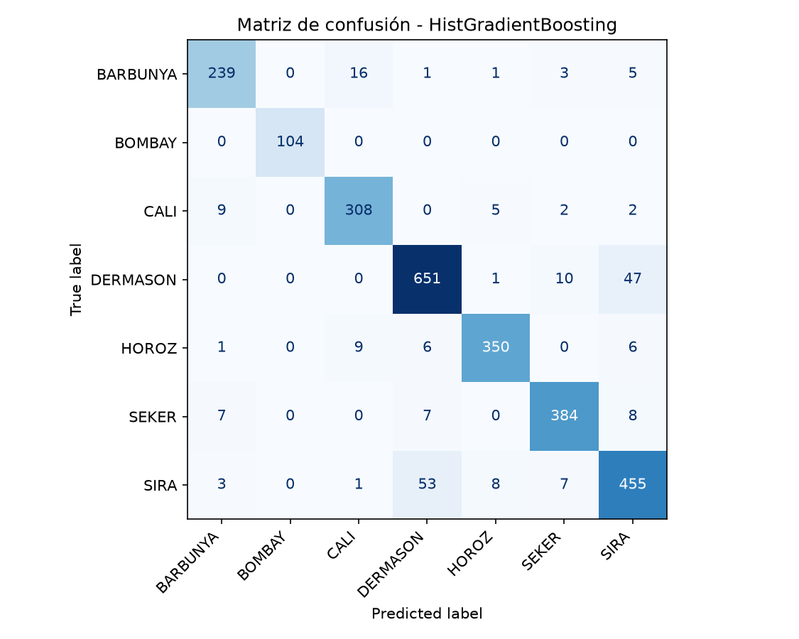

# Reporte Sprint 2 - Modelado y evaluación

**Proyecto:** Clasificación de variedades de frijol seco (Dry Bean Dataset)
**Metodologías:** CRISP-DM · TDSP · Scrum ML
**Semilla:** `random_state=42` · **Train/Test:** 80% / 20% estratificado

## 1. Resumen del sprint

Se entrenaron tres modelos sobre los datos preparados en el Sprint 1:

| Modelo | Configuración |
|---|---|
| **Baseline** | `StandardScaler` + `LogisticRegression(max_iter=1000)` |
| **Alternativo** | `RandomForestClassifier(n_estimators=200, class_weight="balanced")` |
| **Tercero** | `HistGradientBoostingClassifier(l2_regularization=1.0)` |

El escalamiento del baseline se ajustó solo con train (dentro del pipeline) para
no filtrar información del conjunto de prueba.

## 2. Protocolo de evaluación

1. **Hold-out:** métricas sobre las 2.709 filas de test que nunca vieron los modelos.
2. **Validación cruzada 5-fold** sobre train: se usa para **decidir** entre modelos,
   porque una única partición de test no distingue diferencias de milésimas.
3. **Decisión CRISP-DM:** se prioriza el F1 macro medio de la validación cruzada;
   ante empate (< 0,005) se prefiere el modelo más simple y rápido.

## 3. Comparación en test (hold-out)

| modelo | accuracy | f1_macro | f1_weighted | balanced_accuracy | precision_macro | recall_macro | train_seconds |
|---|---|---|---|---|---|---|---|
| Logistic Regression | 0.919 | 0.931 | 0.920 | 0.930 | 0.931 | 0.930 | 0.106 |
| Random Forest | 0.919 | 0.931 | 0.919 | 0.931 | 0.931 | 0.931 | 0.366 |
| HistGradientBoosting | 0.919 | 0.931 | 0.919 | 0.931 | 0.932 | 0.931 | 0.431 |

### Comparación de métricas en test

La coincidencia media entre las predicciones de los modelos es **96.05%**: comparten casi la misma frontera de decisión y se diferencian en casos límite.

## 4. Validación cruzada 5-fold

| modelo | F1 macro medio | Desv. estándar | Folds |
|---|---|---|---|
| Logistic Regression | 0.9360 | 0.0031 | 0.9378 · 0.9337 · 0.9336 · 0.9336 · 0.9412 |
| Random Forest | 0.9352 | 0.0016 | 0.9373 · 0.9337 · 0.9344 · 0.9337 · 0.9368 |
| HistGradientBoosting | 0.9429 | 0.0032 | 0.9430 · 0.9457 · 0.9429 · 0.9370 · 0.9459 |

### F1 macro con validación cruzada

## 5. Evaluación por clase

### Logistic Regression

| clase | precision | recall | f1-score | support |
|---|---|---|---|---|
| BARBUNYA | 0.925 | 0.891 | 0.908 | 265 |
| BOMBAY | 1.000 | 1.000 | 1.000 | 104 |
| CALI | 0.911 | 0.942 | 0.926 | 326 |
| DERMASON | 0.927 | 0.907 | 0.917 | 709 |
| HOROZ | 0.964 | 0.944 | 0.954 | 372 |
| SEKER | 0.932 | 0.943 | 0.938 | 406 |
| SIRA | 0.858 | 0.886 | 0.872 | 527 |
| macro avg | 0.931 | 0.930 | 0.931 | 2709 |

### Random Forest

| clase | precision | recall | f1-score | support |
|---|---|---|---|---|
| BARBUNYA | 0.922 | 0.898 | 0.910 | 265 |
| BOMBAY | 1.000 | 1.000 | 1.000 | 104 |
| CALI | 0.921 | 0.936 | 0.928 | 326 |
| DERMASON | 0.920 | 0.910 | 0.915 | 709 |
| HOROZ | 0.964 | 0.946 | 0.955 | 372 |
| SEKER | 0.924 | 0.958 | 0.941 | 406 |
| SIRA | 0.866 | 0.869 | 0.867 | 527 |
| macro avg | 0.931 | 0.931 | 0.931 | 2709 |

### HistGradientBoosting

| clase | precision | recall | f1-score | support |
|---|---|---|---|---|
| BARBUNYA | 0.923 | 0.902 | 0.912 | 265 |
| BOMBAY | 1.000 | 1.000 | 1.000 | 104 |
| CALI | 0.922 | 0.945 | 0.933 | 326 |
| DERMASON | 0.907 | 0.918 | 0.912 | 709 |
| HOROZ | 0.959 | 0.941 | 0.950 | 372 |
| SEKER | 0.946 | 0.946 | 0.946 | 406 |
| SIRA | 0.870 | 0.863 | 0.867 | 527 |
| macro avg | 0.932 | 0.931 | 0.931 | 2709 |

## 6. Matrices de confusión y errores

- **Logistic Regression:** DERMASON → SIRA (53 casos, 7.5%), SIRA → DERMASON (41 casos, 7.8%), BARBUNYA → CALI (18 casos, 6.8%)
- **Random Forest:** SIRA → DERMASON (48 casos, 9.1%), DERMASON → SIRA (47 casos, 6.6%), BARBUNYA → CALI (17 casos, 6.4%)
- **HistGradientBoosting:** SIRA → DERMASON (53 casos, 10.1%), DERMASON → SIRA (47 casos, 6.6%), BARBUNYA → CALI (16 casos, 6.0%)

### Matriz de confusión - Logistic Regression

### Matriz de confusión - Random Forest

### Matriz de confusión - HistGradientBoosting

**Pregunta del laboratorio:** ¿qué clases se confunden más entre sí?

La confusión principal se da entre `SIRA` y `DERMASON`, variedades de tamaño y
forma cercanos, y ocurre en los tres modelos. `BOMBAY`, la clase más pequeña y
minoritaria, se clasifica sin errores: sus medidas geométricas son claramente
distintas. El límite del modelo está en las variedades parecidas, no en las clases
con pocos ejemplos.

## 7. Importancia de variables

| # | Variable | Importancia |
|---|---|---|
| 1 | Perimeter | 0.109 |
| 2 | ShapeFactor1 | 0.102 |
| 3 | Compactness | 0.095 |
| 4 | ShapeFactor3 | 0.094 |
| 5 | MinorAxisLength | 0.093 |
| 6 | EquivDiameter | 0.067 |
| 7 | Roundness | 0.062 |
| 8 | AspectRatio | 0.060 |
| 9 | Eccentricity | 0.059 |
| 10 | Area | 0.058 |

La importancia se calcula con el Random Forest (el gradient boosting no expone
importancias por impureza). Indica qué variables fueron útiles para separar
clases; **no prueba causalidad**. Lideran `Perimeter`, `ShapeFactor1`, `Compactness`, `ShapeFactor3`, lo que refuerza el
hallazgo del EDA: la combinación de tamaño y forma es lo que discrimina las
variedades, no una única medida.

## 8. Decisión CRISP-DM

- **Modelo seleccionado:** `HistGradientBoosting`
- **Métrica de decisión:** `cv_f1_macro_mean`
- **Diferencia con el segundo:** 0.0069
- **Justificación:** HistGradientBoosting supera a Logistic Regression por 0.0069 de cv_f1_macro_mean, por lo que pasa a la fase de despliegue.

## 9. Artefacto generado

- Modelo: `outputs/models/modelo_final_drybean.joblib`
- Metadatos: `outputs/models/modelo_final_drybean.metadata.json`

## 10. Conclusiones del sprint

1. Los tres modelos se mueven entre 91.95% y 91.95% de
   accuracy: el problema está bien planteado y las variables geométricas son
   informativas.
2. Las diferencias entre modelos son inferiores a 1 punto porcentual, muy cerca
   del ruido de una muestra de 2.709 filas. El techo parece estar en las variables
   disponibles, no en el algoritmo.
3. La validación cruzada ordena con más estabilidad que el hold-out y es la base
   de la decisión: `HistGradientBoosting` gana en las 5 particiones.
4. `SIRA` ↔ `DERMASON` es la confusión dominante (`SIRA` →
   `DERMASON`, 53 casos; `DERMASON` →
   `SIRA`, 47 casos). `BOMBAY` se separa
   sin errores (recall = 1,000).
5. En el modelo seleccionado, las clases minoritarias quedan así: `BOMBAY`: recall = 1.000 (soporte 104) · `BARBUNYA`: recall = 0.902 (soporte 265).
6. El modelo final se guarda con `joblib` y metadatos, listo para la demo de
   despliegue del Sprint 3.
