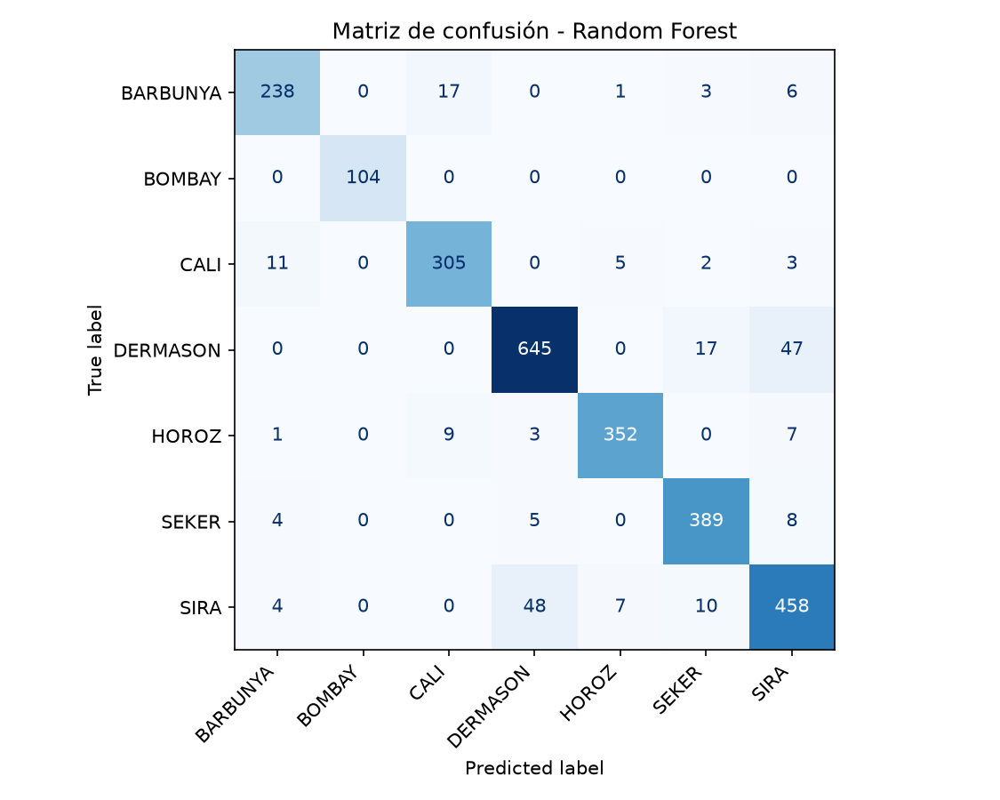
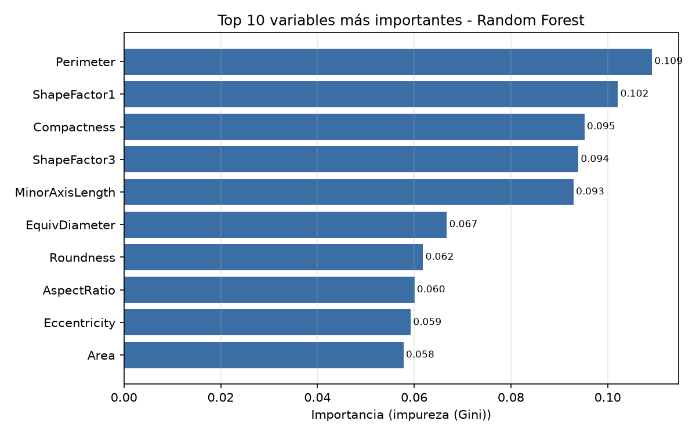

# Reporte Sprint 2 - Modelado y evaluación

**Proyecto:** Clasificación de variedades de frijol seco (Dry Bean Dataset)
**Metodologías:** CRISP-DM · TDSP · Scrum ML
**Semilla:** `random_state=42` · **Train/Test:** 80% / 20% estratificado

## 1. Resumen del sprint

Se entrenaron dos modelos sobre los datos preparados en el Sprint 1:

| Modelo | Configuración |
|---|---|
| **Baseline** | `StandardScaler` + `LogisticRegression(max_iter=1000)` |
| **Alternativo** | `RandomForestClassifier(n_estimators=200, class_weight="balanced")` |

El escalamiento se ajustó solo con train (dentro del pipeline) para no filtrar
información del conjunto de prueba.

## 2. Comparación de métricas (test)

| modelo | accuracy | f1_macro | f1_weighted | balanced_accuracy | precision_macro | recall_macro | train_seconds |
|---|---|---|---|---|---|---|---|
| baseline | 0.919 | 0.931 | 0.920 | 0.930 | 0.931 | 0.930 | 0.104 |
| forest | 0.919 | 0.931 | 0.919 | 0.931 | 0.931 | 0.931 | 0.373 |

Ambos modelos coinciden en **96.05%** de las predicciones del conjunto de prueba (2709 filas) y aciertan la misma cantidad de casos (2491 de 2709): el desempate lo da el F1 macro y el costo computacional.

## 3. Evaluación por clase

### Logistic Regression (baseline)

| clase | precision | recall | f1-score | support |
|---|---|---|---|---|
| BARBUNYA | 0.925 | 0.891 | 0.908 | 265 |
| BOMBAY | 1.000 | 1.000 | 1.000 | 104 |
| CALI | 0.911 | 0.942 | 0.926 | 326 |
| DERMASON | 0.927 | 0.907 | 0.917 | 709 |
| HOROZ | 0.964 | 0.944 | 0.954 | 372 |
| SEKER | 0.932 | 0.943 | 0.938 | 406 |
| SIRA | 0.858 | 0.886 | 0.872 | 527 |
| macro avg | 0.931 | 0.930 | 0.931 | 2709 |

### Random Forest (alternativo)

| clase | precision | recall | f1-score | support |
|---|---|---|---|---|
| BARBUNYA | 0.922 | 0.898 | 0.910 | 265 |
| BOMBAY | 1.000 | 1.000 | 1.000 | 104 |
| CALI | 0.921 | 0.936 | 0.928 | 326 |
| DERMASON | 0.920 | 0.910 | 0.915 | 709 |
| HOROZ | 0.964 | 0.946 | 0.955 | 372 |
| SEKER | 0.924 | 0.958 | 0.941 | 406 |
| SIRA | 0.866 | 0.869 | 0.867 | 527 |
| macro avg | 0.931 | 0.931 | 0.931 | 2709 |

Clases con menor desempeño en Random Forest:

- `SIRA`: F1 = 0.8674 · recall = 0.8691 · soporte = 527
- `BARBUNYA`: F1 = 0.9101 · recall = 0.8981 · soporte = 265

## 4. Matriz de confusión y errores

- **Baseline:** DERMASON → SIRA (53 casos, 7.5%), SIRA → DERMASON (41 casos, 7.8%), BARBUNYA → CALI (18 casos, 6.8%)
- **Random Forest:** SIRA → DERMASON (48 casos, 9.1%), DERMASON → SIRA (47 casos, 6.6%), BARBUNYA → CALI (17 casos, 6.4%)

**Pregunta del laboratorio:** ¿qué clases se confunden más entre sí?

La confusión principal se da entre `SIRA` y `DERMASON`, variedades de tamaño y
forma cercanos, en ambos sentidos. En contraste, `BOMBAY` (la clase más pequeña y
minoritaria) se clasifica sin errores: es tan distinta en tamaño que las medidas
geométricas la separan fácilmente. El desbalance no oculta los errores de las
clases minoritarias, pero sí hace que accuracy por sí sola no sea suficiente para
evaluar el modelo.

## 5. Importancia de variables

| # | Variable | Importancia |
|---|---|---|
| 1 | Perimeter | 0.109 |
| 2 | ShapeFactor1 | 0.102 |
| 3 | Compactness | 0.095 |
| 4 | ShapeFactor3 | 0.094 |
| 5 | MinorAxisLength | 0.093 |
| 6 | EquivDiameter | 0.067 |
| 7 | Roundness | 0.062 |
| 8 | AspectRatio | 0.060 |
| 9 | Eccentricity | 0.059 |
| 10 | Area | 0.058 |

La importancia indica qué variables usó el bosque para separar clases; **no
prueba causalidad**. En este entrenamiento lideran `Perimeter`, `ShapeFactor1`, `Compactness`, `ShapeFactor3`, lo que
refuerza el hallazgo del EDA: la combinación de tamaño y forma es lo que
discrimina las variedades, no una única medida.

## 6. Decisión CRISP-DM

- **Modelo seleccionado:** `baseline`
- **Diferencia de F1 macro:** 0.0004
- **Criterio:** priorizar `f1_macro`, revisar errores por clase y preferir el
  modelo más simple cuando el desempeño es equivalente.
- **Justificación:** La diferencia de F1 macro entre forest y baseline es 0.0004 (< 0.005), por lo que se prefiere el modelo mas simple y rapido: baseline.

## 7. Artefacto generado

- Modelo: `outputs/models/modelo_final_drybean.joblib`
- Metadatos: `outputs/models/modelo_final_drybean.metadata.json`

## 8. Conclusiones del sprint

1. Ambos modelos superan el 91% de accuracy, lo que confirma que las variables
   geométricas son informativas para separar las 7 variedades.
2. El F1 macro es la métrica de decisión porque las clases están desbalanceadas
   (6,79:1), tal como se identificó en el Sprint 1.
3. Con `class_weight="balanced"`, el Random Forest alcanza estos niveles en las
   dos clases minoritarias: `BOMBAY`: recall = 1.000 (soporte 104) · `BARBUNYA`: recall = 0.898 (soporte 265).
4. La confusión más frecuente del bosque es `SIRA` → `DERMASON`
   (48 casos, 9.1% de esa clase), seguida de
   `DERMASON` → `SIRA` (47 casos).
5. El modelo seleccionado queda guardado con `joblib` y metadatos, listo para la
   demo de despliegue del Sprint 3.
